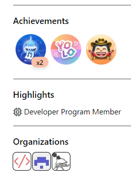
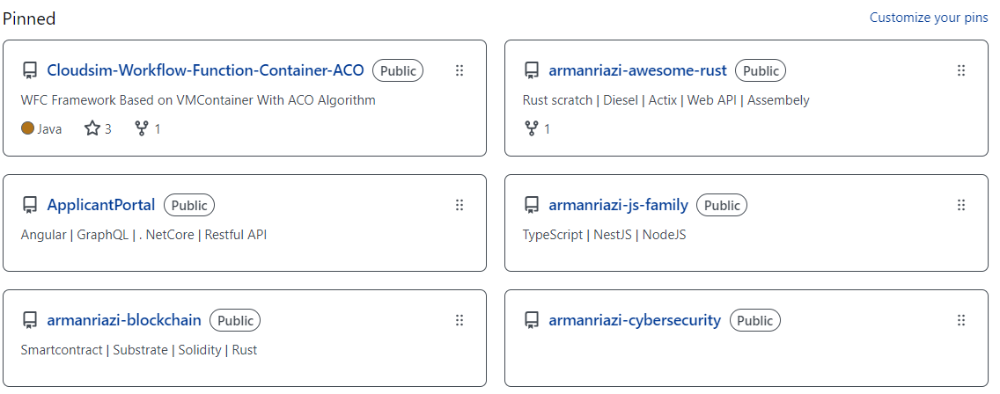

<!--
**armanriazi/armanriazi** is a ✨ _special_ ✨ repository because its `README.md` (this file) appears on your GitHub profile.
-->

- 💬 Ask me about [About](https://armanriazi.github.io/about/)
- 📫 How to reach me: [All of things you need to know](https://armanriazi.github.io)

Hi 👋 I am Arman
======================

**IT MAN*
---------------------------

I began programming in a non-graphical environment using Basic when I was 17 years old. Prior to that, I had worked with FrontPage when my older brother purchased a Pentium 2 that ran Windows NT.

* **Backend Web Developer** with 15 years of experience in backend development. I have proven expertise in ERP, CRM, CMS, and e-commerce platforms and am adept at blockchain, microservices architecture and cloud-native solutions. I am recognized for optimizing system efficiency and delivering customer-centric solutions. I excel in both remote and on-site collaborative environments.

* **Results-driven Cybersecurity Professional** with over 5 years of comprehensive experience in both defensive and offensive security measures. I am particularly skilled in enhancing application defenses and deploying secure architectures. I have a proven track record of implementing best practices that strengthen cybersecurity protocols across various environments, including on-premises infrastructures and cloud-based systems. My expertise enables organizations to proactively address vulnerabilities and effectively safeguard their digital assets.

* 🌍  I lived on Earth when it was created 4M years ago!
* ✉️  You can contact me at [armanriazi.uni@gmail.com](mailto:armanriazi.uni@gmail.com)
* 🧠  I've been learning & teaching such as Rust programming and Cybersecurity.

<!--<a href="https://www.github.com/armanriazi" target="_blank" rel="noreferrer"></a>-->

- **Activities of the account were hidden but you can gain access to the pinned repositories**
  
<p align="center">
  <a href="#" target="_blank" rel="noreferrer"></a>
<a href="#" target="_blank" rel="noreferrer"></a>
</p>

### Skills

<p align="left">
<a href="https://www.rust-lang.org/" target="_blank" rel="noreferrer"></a>  
<a href="https://nodejs.org/en/" target="_blank" rel="noreferrer"></a>
<a href="https://attack.mitre.org/" target="_blank" rel="noreferrer"></a>
<!--<a href="https://kusama.network/" target="_blank" rel="noreferrer"></a>
<a href="https://ethereum.org/en/" target="_blank" rel="noreferrer"></a>
<a href="https://polkadot.network/" target="_blank" rel="noreferrer"></a>-->
</p>

<!--
### Status of the GitHub Page 

<a href="http://www.github.com/armanriazi"></a><a href="https://github.com/armanriazi" align="left"></a>
-->

<!--<a href="http://www.github.com/armanriazi"></a>
-->


### About Me

- 🔭 I’m currently working as a remote. I’m currently engaged in expanding and growth skills with some and it will be profitable for companies. 
  (I believe in Synergy)
- 😄 Pronouns: He/Him
- ⚡ Website: [Click](https://armanriazi.github.io/)
- 👯 My hobbies are listening to piano, playing football, and read IT magazines.

<!--
### Socials

<p align="left"> <a href="https://www.armanriazi.giot" target="_blank" rel="noreferrer"></a> 
  
  <a href="https://www.linkedin.com/in/armanriazi/" target="_blank" rel="noreferrer"></a></p>
-->

### Support Me

**Before click on please contact me**

MetaMask(Multi Network Blockchain Support): 

```plaintext
0xde5D732a5AB44832E1c69b18be30834639F44A2c
```

#### Sponsoring

**Before click on please contact me**

[](https://github.com/sponsors/armanriazi)

<a href="https://liberapay.com/armanriazi/donate"></a>

<a href='https://ko-fi.com/armanriazi' target='_blank'></a>

